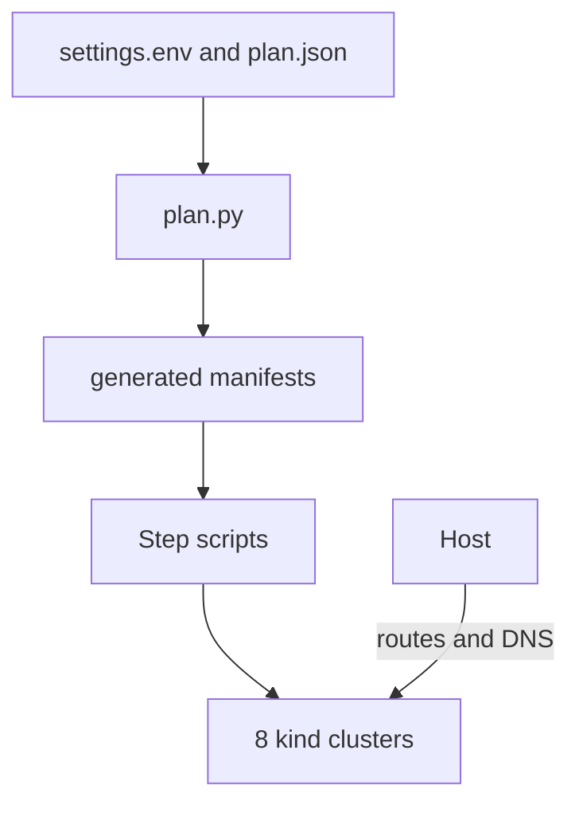

# Local Kubernetes platform

This project makes a VMware Kubernetes Service (VKS) style environment on one Linux host.
It uses Docker, kind, Calico and MetalLB. It does not install VMware VKS or AKO.

- 8 clusters, each with one node and a fixed IP block.
- 31 namespaces, each with a fixed range of 50 IPs.
- One NGINX Ingress Controller with a fixed IP in each namespace.
- Prometheus, Grafana, HAProxy, CoreDNS, PostgreSQL, MongoDB and InfluxDB.
- Gateway API CRDs, without a Gateway controller.
- The pcap-analyzer application, built from its GitHub repository.



## Requirements

- Linux on amd64 with systemd, cgroup v2 and `systemd-resolved`.
- `curl`, `sudo`, `openssl`, `python3`, `iptables`.
- 12 GiB of free memory. 8 clusters need swap on a 22 GiB host.
- Internet access during the installation.

## Settings

Clone this repository to `$PLATFORM_ROOT/installation`. Then edit `settings.env`.

| Setting | Default | Effect |
|---|---|---|
| `PLATFORM_NAME` | `vks` | Prefix of Docker, network, registry, label and image names. Maximum 11 characters. |
| `PLATFORM_ROOT` | `/data/vks` | Folder for all programs and data. |
| `DOMAIN` | `ubuntu.local` | DNS zone of dnscore. |

| File | Content |
|---|---|
| `00-common/plan.json` | Networks, clusters and namespaces. |
| `00-common/versions.env` | Pinned versions. |

Run `python3 00-common/plan.py` after a change.
Do not change `settings.env` on a running platform. Install again instead.

## Installation

Run the sudo commands in a normal terminal.

```bash
python3 00-common/plan.py
./01-platform/install.sh
sudo ./01-platform/root-setup.sh
./01-platform/install.sh
./02-clusters/install.sh
sudo -v && ./02-clusters/routes.sh
```

Then run `install.sh` and `verify.sh` in folders 03 to 09, 11, 12 and 15, in number order.
Each folder has a `README.txt` and a `ROADMAP.md`.

| Step | Folder |
|---|---|
| 01 | `01-platform` |
| 02 | `02-clusters` |
| 03 | `03-namespaces` |
| 04 | `04-ako-loadbalancer` |
| 05 | `05-nginx-ingress` |
| 06 | `06-gateway-api` |
| 07 | `07-prometheus-grafana` |
| 08 | `08-haproxy` |
| 09 | `09-images` |
| 10 | `10-demo-app` (postponed) |
| 11 | `11-dnscore` |
| 12 | `12-databases` |
| 13 | `13-central-operations` (`verify.sh` only) |
| 14 | `14-final-review` |
| 15 | `15-pcap-analyzer` |

## Use kubectl

Add this line to `~/.bashrc`. Use your value of `PLATFORM_ROOT`.

```bash
source /data/vks/installation/02-clusters/env.sh
```

```bash
kubectl config get-clusters
kubectl config use-context test
kubectl get ns
```

## After a reboot

Swap, host routes and host DNS do not stay after a reboot.

```bash
sudo ./01-platform/swap-on.sh 16
./02-clusters/resume-all.sh
sudo -v && ./02-clusters/routes.sh
```

## Secrets

The scripts make random passwords in `$PLATFORM_ROOT/runtime/secrets`.
This folder is outside the repository. Do not add secrets to Git.

## Status

See `14-final-review/REVIEW.md` for test results and items that are not tested.
